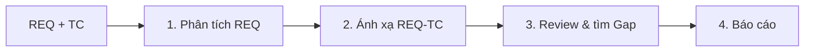

# WORKFLOW v1 — Basic Requirement–Test Case Review

> **Trạng thái:** thử nghiệm (baseline). Mục tiêu là kiểm chứng phiên bản đơn giản trước khi áp dụng Viewpoint, RBT và BA/UAT.
> **Nguyên tắc:** Không tự sửa Test Case; không tự suy diễn expected result khi requirement thiếu.

## 1. Mục tiêu

Một Tester có Requirement và bộ Test Case hiện tại cần biết: (a) TC có đúng spec không, (b) phần nào chưa test, (c) cần sửa TC nào. Chạy bằng một lệnh `/qa-review` và tạo báo cáo Markdown.

## 2. Đầu vào

Bắt buộc: `input/requirements.md`, `input/testcases.csv` hoặc đường dẫn do người dùng chỉ định. Khuyến nghị: ticket comments, ảnh, API spec có liên quan; khi thiếu nguồn nói rõ. Giữ nguyên ID và dữ liệu gốc.

## 3. Quy trình 4 bước

### Bước 1 — Requirement Analysis
- Đọc đúng tài liệu, xác định chức năng, điều kiện, validation, ngoại lệ, actor, giới hạn đã được nêu rõ.
- Gán `REQ-001...` khi nguồn chưa có ID; giữ ID gốc nếu có.
- Ghi câu hỏi khi thiếu expected; không phỏng đoán như rule đã duyệt.

### Bước 2 — Requirement ↔ Test Case Mapping
- Ánh xạ từng REQ với TC liên quan dựa trên Preconditions, Steps, Expected, **không chỉ title**.
- Cho phép một TC ánh xạ nhiều REQ; không mặc định có TC = đủ coverage.
- Các TC không ánh xạ được ghi riêng (out-of-scope, obsolete, hoặc cần clarification).

### Bước 3 — Test Case Review + Gap
- Rà: expected đúng; precondition rõ; steps thực thi được; test data có giá trị cụ thể; kết quả pass/fail quan sát được; trường hợp positive/negative/boundary liên quan; duplicate; regression cơ bản.
- Phân loại: `Covered`, `Partial`, `Missing`, `Need Clarification`, `Conflict`.
- Các thiếu sót phát hiện trong negative, boundary phải gắn căn cứ; rủi ro ngoài yêu cầu ghi `Suggested Risk`, không gọi là bug Confirmed.

### Bước 4 — QA Review Report
Xuất `output/review-report.md` gồm bảng REQ ↔ TC, danh sách TC cần sửa, Missing Case, Clarification, Regression ngắn và giới hạn input. Đồng thời xuất `output/findings.json` theo schema dùng so sánh.

## 4. Kết luận và cổng duyệt

Tester đọc report, kiểm tra bằng chứng, quyết định sửa TC ngoài file gốc; AI không tự lưu đè. Không tuyên bố PASS/FAIL khi chưa chạy test.

## 5. Giới hạn của phiên bản

v1 chưa có Test Viewpoint, 9 tiêu chí review chính thức, risk matrix, BA goal, UAT, golden set và delta. Giữ nguyên các giới hạn này để so sánh công bằng với v2–v4.

## 6. Cách chạy

`/qa-review Review input/requirements.md với input/testcases.csv. Xuất output/review-report.md và output/findings.json theo evaluation schema. Trả lời tiếng Việt.`
