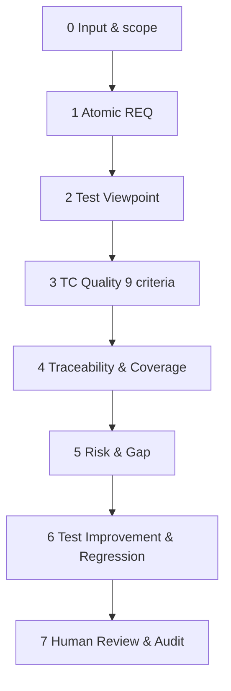

# WORKFLOW v2 — Viewpoint, Risk & Coverage Review

> **Trạng thái:** bản so sánh. Dựa trên tinh thần workflow 7 giai đoạn và bộ Rule Viewpoint/9 tiêu chí đã tham khảo.
> **Phạm vi:** tập trung QA kỹ thuật và thiết kế test. Chưa có lớp BA mục tiêu người dùng/UAT như v3.

## 1. Mục tiêu

Kiểm chứng không chỉ "REQ đã có TC chưa" mà còn "những góc nhìn kiểm thử cần thiết của REQ đã được xác minh tới đâu". Traceability chính: **REQ → VP → TC**. Mọi finding có source, mức tác động, đề xuất.

## 2. 8 giai đoạn, chạy nội bộ

### 0. Chuẩn hóa đầu vào
- Requirement + Test Case là tối thiểu. Đọc metadata, phiên bản; ghi file/section/sheet; đánh dấu input không thể đọc.
- Không tự coi trạng thái trên UI, testcase cũ hoặc tên mới nhất là nguồn duy nhất. Mâu thuẫn đưa câu hỏi.
- Dữ liệu dự án thật cần quyền dùng với AI, che PII/token.

### 1. Requirement decomposition
- Tách thành mệnh đề nguyên tử có thể kiểm; mỗi mệnh đề một ID, loại functional/business/validation/permission/integration/nonfunctional.
- Kiểm tra mơ hồ, thiếu ranh giới, các điều kiện trạng thái, conflict; ghi `Q-ID` cho BA/PdM.

### 2. Test Viewpoint
- Mỗi REQ tìm VP phù hợp, không rải tất cả loại VP cho mọi REQ.
- VP gồm Functional, Input, Boundary, Combination, State, Data Integrity, Integration, Authorization, Resilience, Localization, Security nếu applicable.
- Gán `VP-ID`, REQ, test technique, mức độ rủi ro. VP không có căn cứ đưa `Proposed VP` và **không** coi là AC đã xác nhận.

### 3. Review TC theo 9 tiêu chí
- Correctness, Clarity, Verifiability, Independence, Single Objective, Test Type, Duplication, Priority, Executability.
- Kết luận cho TC: Keep, Modify, Split, Merge, Remove, Clarify. Có câu trích và sửa cụ thể; không sửa source TC.

### 4. Requirement/VP Coverage
- Bảng REQ ↔ VP ↔ TC. `Covered` chỉ khi điều kiện VP thật sự được xác minh bởi Step+Data+Expected, không dựa vào tên TC.
- `Partial`, `Missing`, `Unknown/N/A` có lý do; không bắt một chức năng UI phải có negative/boundary khi không áp dụng.
- Báo cáo theo module, priority, category, không chỉ một tỷ lệ tổng.

### 5. Gap, conflict và risk
- Tách Confirmed Gap (nguồn đã xác nhận), Potential Risk (giả thuyết), Need Clarification (chưa có quyết định), Incorrect Expected, Duplicate.
- Risk: Impact × Likelihood (thang mẫu 1–3 mỗi chiều); với tác động nghiêm trọng, bắt buộc human review.
- Finding `FND-ID`, nguồn, REQ/VP/TC, mức độ, confidence, suggested action.

### 6. Improvement và regression
- Chỉ đề xuất TC cho gap có cơ sở; nếu xin generate, dùng kỹ thuật EP/BVA/decision table/state transition.
- Regression từ change scope, data/shared dependency, bug cũ; chia smoke/core/full theo rủi ro.
- Exploratory charter và end-to-end scenarios là tùy chọn, không bắt buộc với mọi ticket.

### 7. Tester/QA Lead Review
- Tester quyết định sửa TC, QA Lead rà High/Critical. AC mơ hồ phải hỏi nguồn có thẩm quyền.
- Xuất `output/review-report.md`, `output/coverage-matrix.md`, `output/findings.json`; không đánh PASS khi chưa execute.

## 3. Định dạng output

Bảng REQ–VP–TC gồm ID, nội dung, test types, mapped TC, coverage và gap. Bảng TC gồm 9 tiêu chí, quyết định, đề xuất sửa. Report tóm tắt rủi ro và câu hỏi còn chặn. Machine JSON dùng schema chung để benchmark.

## 4. Không có trong v2

Chưa có xác nhận Business Goal/Persona như một gate chính thức; không sản xuất UAT pack dựa trên mục tiêu người dùng; không có Delta Mode tối ưu riêng. Giữ khác biệt để đo tiến bộ qua các phiên bản.

## 5. Cách chạy

`/qa-review Review input/requirements.md với input/testcases.csv. Ưu tiên REQ→VP→TC, 9 tiêu chí, gap, risk; xuất output/review-report.md, output/coverage-matrix.md, output/findings.json.`
