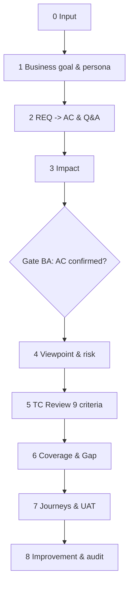

# WORKFLOW v3 — Tester kiêm BA và kiểm thử người dùng

> **Trạng thái:** bản so sánh dựa theo tài liệu ba lớp chín phase (2026-11-11).
> **Tư tưởng:** không chỉ đánh giá TC có đúng Requirement, mà còn Requirement có hợp lý và người dùng có hoàn thành công việc không.

## 1. Ba lớp năng lực

- **BA (trước):** Mục tiêu nghiệp vụ, actor/persona, As-is/To-be, REQ→Acceptance Criteria, clarification, impact.
- **QA (giữa):** AC→VP→TC, 9 tiêu chí, risk, traceability, gap, regression.
- **User/UAT (sau, có thể chuẩn bị song song):** Task theo persona, script UAT cho người không chuyên, usability, phân loại feedback.

## 2. Chín phase: AI chuẩn bị / Tester quyết định

| Phase | AI chuẩn bị | Con người quyết định | Đầu ra |
|---|---|---|---|
| 0. Input | Manifest, nguồn, glossary | Phạm vi và input áp dụng | Manifest |
| 1. Business | Mục tiêu, vai trò, persona và as-is/to-be draft | Xác nhận mục tiêu/persona | Business context |
| 2. AC | REQ nguyên tử, AC Given/When/Then khi phù hợp, ambiguity, Q&A theo mức ảnh hưởng | Chọn câu hỏi gửi BA/PdM/khách, duyệt AC | AC matrix, Clarification log |
| 3. Impact | Module/API/data/UI/email và TC cũ bị ảnh hưởng | Chọn regression/UAT scope | Impact matrix |
| 4. VP | Catalog VP, kỹ thuật test, risk | Duyệt VP High/Critical | Viewpoint matrix |
| 5. TC Quality | Chấm 9 tiêu chí, đề nghị Keep/Modify/Split/Merge/Remove/Clarify | Tester quyết định TC | Review sheet |
| 6. Coverage | AC↔VP↔TC, Confirmed Gap/Potential Risk/Clarify | QA Lead quyết định gap/risk | Coverage + FND |
| 7. UAT | Persona task, journey, UAT pack, usability, feedback triage | Tester/khách thực hiện, PdM duyệt thay đổi | UAT artifacts |
| 8. Closure | TC đề xuất, regression, audit, lesson | Duyệt cuối | Summary |

## 3. BA gate & trạng thái AC

- AC dạng `DRAFT` chưa được dùng như yêu cầu được khách phê duyệt. Gắn câu hỏi có ưu tiên, source, owner, decision date.
- AC `CONFIRMED` là đầu vào chuẩn cho QA coverage chính thức; những AC chưa được confirm có thể phân tích nhưng phải ghi `Provisional` nếu dùng làm cơ sở.
- Không tự dựng persona từ role. Persona phải dựa trên khảo sát, tài liệu hoặc được gắn Draft rõ ràng.
- Q&A: ưu tiên câu hỏi chặn test, ảnh hưởng thiết kế, chi tiết. Nếu có hai phương án phải nêu hệ quả và độ chắc chắn; không bịa phương án kinh doanh.

## 4. QA traceability và 9 tiêu chí

- Liên kết `Goal → REQ → AC → VP → TC`, many-to-many hợp lệ nhưng `Covered` chỉ khi kiểm được toàn bộ điều kiện VP liên quan.
- Review từng TC theo Correctness / Clarity / Verifiability / Independence / Single Objective / Test Type / Duplication / Priority / Executability.
- Chia finding thành Confirmed Gap, Potential Risk, Need Clarification, Incorrect Expected, Duplicate.
- Risk ưu tiên Impact × Likelihood; QA Lead rà finding High/Critical.

## 5. Lớp UAT

- Chọn 2–4 persona **nếu có căn cứ** và 1–3 hành trình mỗi persona; bắt đầu từ mục tiêu người dùng, không phải danh sách UI.
- UAT pack: mục tiêu, đối tượng, môi trường, dữ liệu, precondition, checkpoint, điều kiện đạt; tiêu chí task completion xác định trước khi chạy.
- Feedback phân loại Bug (trái AC/invariant đã xác nhận), Gap Requirement, Change Request, Usability, Subjective Feedback hoặc Pending nếu chưa đủ bằng chứng.
- Không tự báo người dùng đã hoàn thành nhiệm vụ khi chưa có kết quả test thực tế.

## 6. Chế độ sử dụng

- **quick**: phase 0, 2, 5, 6 và audit tóm tắt; business context có sẵn thì reuse, không dựng persona mới. Ưu tiên 1 file `review-sheet.csv`.
- **full**: chín phase, có BA gate/QA gate và UAT pack khi phạm vi phù hợp; không ép mọi feature phải có test usability.
- **uat**: chỉ tập trung lớp User nếu có AC, mục tiêu, feedback/journey.
- v3 chưa có giới hạn batch Quick chặt và Delta Mode độc lập như v4; để lộ giới hạn khi đánh giá.

## 7. Đầu ra

`output/review-sheet.csv` (TC + AI Issue/Suggested Fix/Review Decision), `output/qa-review-summary.md`; Full bổ sung `clarification-log.md`, `impact-matrix.md`, `uat-pack.md`. Xuất `output/findings.json` schema chung khi benchmark.

## 8. Cách chạy

`/qa-review quick Review input/requirements.md với input/testcases.csv, ghi rõ provisional AC và nguồn, xuất findings.json.`

`/qa-review full ...` hoặc `/qa-review uat fixtures/uat-feedback/requirements.md, feedback.csv ...`.
