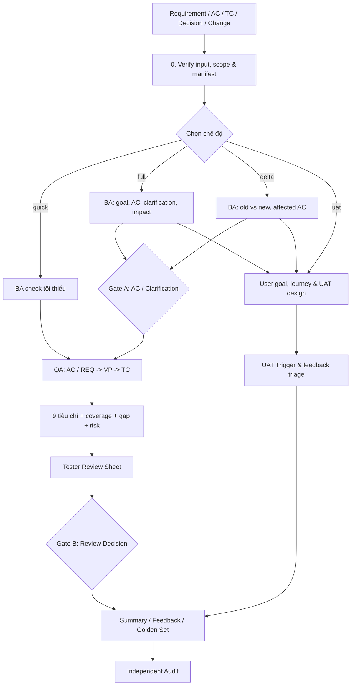

# QA Review Workflow v4 — Tài liệu thiết kế trung tâm

> **Trạng thái:** DRAFT — cần Tester/QA Lead/PdM review trước khi áp dụng chính thức.  
> **Phiên bản tài liệu:** v4.0-design | **Ngày:** 2026-11-11  
> **Mục đích:** Quy định **workflow trước**, sau đó mới cải tiến Rules, Skills, Requirement, Test Case, Excel và automation.  
> **Nguyên tắc ưu tiên:** Nếu một rule, prompt hoặc template mâu thuẫn với tài liệu đã được phê duyệt này, phải tạo mục cần điều chỉnh; không tự đổi workflow theo file triển khai.

## 1. Mục tiêu và phạm vi

### 1.1. Bốn câu hỏi workflow phải trả lời

1. **Business validity (BA):** Tài liệu có mô tả đúng mục tiêu nghiệp vụ, người dùng và điều kiện chấp nhận hay không?
2. **Test confidence (QA):** Các Test Case hiện có thực sự kiểm tra được bao nhiêu điều kiện quan trọng, với Expected Result hợp lệ hay không?
3. **User success (UAT):** Người dùng mục tiêu có hoàn thành được công việc của mình và hiểu được bước tiếp theo hay không?
4. **Decision quality:** Finding nào được chấp nhận, ai quyết định, dựa vào bằng chứng nào, và bài học gì được giữ lại?

### 1.2. Không phải mục tiêu của v4.0-design

- Không tự sửa Requirement hoặc Test Case gốc.
- Không tự xác nhận một AC Draft; không tự phê duyệt Test Case hoặc chấp nhận rủi ro.
- Không thực thi UAT/automation rồi tự báo PASS nếu chưa có kết quả chạy và bằng chứng.
- Không bắt Tester thao tác qua chín phase hoặc mở bảy file trung gian.
- Không coi nội dung file này là bằng chứng rằng toàn bộ tính năng Excel/Jira đã được lập trình xong.

### 1.3. Nguyên tắc bất biến

- **Một điểm vào:** `/qa-review` và tùy chọn mode; `quick` mặc định.
- **Một file làm việc chính cho Tester:** bản sao TC gốc + 3 cột AI (`AI Issue`, `Suggested Fix`, `Review Decision`).
- **Dẫn nguồn đến tận kết luận:** source/version/location → REQ → AC → VP → TC → FND.
- **Phân biệt điều đã xác nhận và điều suy đoán:** Confirmed Gap / Potential Risk / Need Clarification.
- **Con người giữ quyền duyệt:** AI đề xuất; người có thẩm quyền quyết định.
- **Ba lớp năng lực là các lớp đánh giá, không phải ba thủ tục phải chạy hết mọi lần.**

## 2. Đối tượng và trách nhiệm

| Vai trò | Trách nhiệm chính | Không được phép ngầm định |
|---|---|---|
| **Tester** | Chọn scope/mode, kiểm tra finding, nhập `Review Decision`, xác nhận data và khả năng thực thi | Không tự coi giả thuyết nghiệp vụ là quyết định của khách |
| **QA Lead** | Duyệt mapping/risk High–Critical, quyết định chấp nhận gap; phê duyệt kết quả review | Không coi coverage là execution PASS |
| **BA/PdM/khách hàng được ủy quyền** | Xác nhận/sửa/loại AC, phê duyệt thay đổi nghiệp vụ và UAT scope | Không để AI tự chuyển Draft → Confirmed |
| **Security/Data owner** | Đồng duyệt những trường hợp hạ mức Critical liên quan bảo mật/dữ liệu | Không cho phép hạ Critical chỉ vì Likelihood thấp |
| **AI Reviewer** | Trích xuất, ánh xạ, phát hiện gap, đề xuất sửa và lập báo cáo | Không tự sửa nguồn, không xác nhận chưa có chứng cứ |
| **AI Auditor (phiên độc lập)** | Kiểm chứng kết quả cuối bằng nguồn gốc; tìm thiếu sót và báo sai | Không sử dụng lập luận nội bộ của AI Reviewer |

## 3. Sơ đồ tổng quát: một lệnh, ba lớp

**Lưu ý:** BA Draft/Conflict không chặn mọi bước QA: chỉ kết luận liên quan mang `PROVISIONAL`/`BLOCKED_BY_SPEC`. Các phần có AC Confirmed vẫn được review bình thường. Hình vẽ thể hiện nhánh nghiệp vụ; không yêu cầu chạy hết nhánh trong mọi mode.

## 4. Chế độ và giới hạn thực thi

| Mode | Khi dùng | Thực hiện | Đầu ra cho người dùng |
|---|---|---|---|
| **quick** (mặc định) | Ticket hằng ngày; đã có Requirement + TC | Kiểm input, rà AC tối thiểu, VP, 9 tiêu chí, coverage, gap, risk | **1 Review Sheet** + thông báo ngắn các vấn đề High–Critical |
| **full** | Feature mới, logic phức tạp, phạm vi lớn, lần đầu review bộ TC khách hàng | BA sâu + QA + impact + đề xuất TC; xem xét UAT triggers | Review Sheet, summary, clarification; tài liệu bổ sung khi cần |
| **delta** | Requirement, AC, comment hoặc behavior được quyết định thay đổi | So sánh baseline old/new + dependency; chỉ rà TC/VP bị ảnh hưởng | Affected TC Sheet và impact summary |
| **uat** | Có trigger UAT hoặc PdM/QA Lead yêu cầu | Persona có chứng cứ, task journey, UAT plan/script, feedback triage | UAT Pack và Feedback Log |
| **audit** | Sau kết quả review quan trọng hoặc chạy golden set | Phiên độc lập kiểm tra bằng chứng/kết quả | Audit Result |

### 4.1. Timebox của Quick Review — giới hạn không được tự vượt

- **Tối đa 01 module và 50 Test Case trong một batch Quick.** Một TC nhiều dòng/bước vẫn tính là một TC; số lượng tính theo **TC ID duy nhất**, không phải số dòng Excel.
- **Mục tiêu thao tác của Tester: 30 phút/batch** (mục tiêu vận hành cần đo, **không phải** thời gian AI có thể tự bảo đảm). Nếu tool không đo được thời gian, không được tuyên bố đã tuân thủ mốc thời gian; ghi thời gian thực tế thủ công/qua log khi có.
- Khi đầu vào vượt 50 TC: chia theo **module → luồng nghiệp vụ → nhóm TC ID**, mỗi batch tối đa 50; tạo danh sách batch và trạng thái `PENDING/REVIEWED` trong manifest. **Không âm thầm bỏ qua TC** và **không tự chuyển sang Full**.
- Khi AI thấy cần Full: ghi `FULL_REVIEW_RECOMMENDED`, **lý do và phạm vi**, để Tester xác nhận trước; Quick vẫn dừng ở phạm vi được cấp.
- Nếu nguồn quá lớn hoặc không đọc đủ, dùng `INPUT_PARTIAL` và nêu cụ thể những file/sheet/range chưa được review; không công bố tổng coverage như đã bao phủ hết.

## 5. Input, Source of Truth và Input Manifest

### 5.1. Input tối thiểu

- Requirement/ticket (hoặc AC từ nguồn được xác nhận) và **bộ Test Case hiện tại** đối với Quick/Full.
- `delta` cần snapshot OLD + NEW hoặc thông tin thay đổi đáng tin cậy; thiếu snapshot thì chạy **degraded impact analysis**, không giả vờ so sánh chính xác.
- `uat` cần mục tiêu công việc, người dùng/vai trò, phạm vi và môi trường; chưa rõ persona thì ghi Draft, không suy từ role.
- Dữ liệu bổ sung theo tính sẵn có: Jira comments/decisions, mockup, API spec, business knowledge, previous bugs, release change list.

### 5.2. Quy tắc ưu tiên nguồn

Không sử dụng thứ tự “file mới nhất thắng”. Đánh giá nguồn bằng **approval, phạm vi áp dụng, effective date và người quyết định**. Ví dụ: một quyết định PdM mới được xác nhận có thể thay thế AC cũ; API contract chỉ quyết định hành vi API trong phạm vi tương ứng. Mâu thuẫn chưa giải quyết → `CONFLICTED` + Clarification, không tự chọn.

### 5.3. Manifest của **mỗi lần chạy**

`Run ID | mode | source path/URL | version/date | owner/approval | module/scope | included sheets/rows | excluded/hidden/out-of-scope | unreadable | batch | activated layers | skipped layers/reasons | limitations | input hash nếu khả dụng`

Với Excel: bảo toàn TC ID, số 0 đầu chuỗi, ô gộp, rich text, sheet ẩn, định dạng có ý nghĩa nghiệp vụ, các dòng tô xám; nếu không xác minh được style, đánh dấu `INPUT_UNVERIFIED`. Không sử dụng dữ liệu cá nhân thật hoặc secret nếu chưa được phê duyệt.

## 6. Lớp BA — từ mục tiêu đến Acceptance Criteria

### 6.1. Chỉ khi có căn cứ, xác định

- Vấn đề nghiệp vụ → mục tiêu → actor → **persona** (phân biệt role và hành vi người dùng).
- As-is / To-be; các bước thay đổi, điểm rẽ nhánh, trạng thái, dữ liệu, API, email và dependency.
- REQ nguyên tử và AC có thể kiểm chứng. Dùng `Given/When/Then` **khi phù hợp**; ràng buộc dữ liệu, bất biến hệ thống, SLA có thể viết dưới dạng điều kiện đo được.

### 6.2. Trạng thái AC

| AC status | Điều kiện | Được phép dùng để kết luận |
|---|---|---|
| `DRAFT` | Do AI/tester đề xuất, chưa có phê duyệt phù hợp | Review tạm thời; coverage chỉ `PROVISIONAL` |
| `CONFIRMED` | Có căn cứ và người có thẩm quyền đã xác nhận | Là cơ sở tính coverage chính thức |
| `CONFLICTED` | Hai nguồn có thẩm quyền mâu thuẫn; chưa giải quyết | `BLOCKED_BY_SPEC` trên phần liên quan |
| `SUPERSEDED` | Đã bị thay thế bằng AC/quyết định mới có hiệu lực | Không tính vào coverage hiện hành, vẫn giữ lịch sử |

### 6.3. Gate A — xác nhận AC và câu hỏi

Gate A có mặt **trong Clarification Log / AC Confirmation**, không ẩn trong câu trả lời AI:

`Q-ID | REQ/AC-ID | Source | Question | Options + consequences (nếu có căn cứ) | Priority | AC Status | Decision | Decision Owner | Decision Date | Evidence Link | Related TC`

- PdM/BA/khách được ủy quyền quyết định `CONFIRMED/SUPERSEDED` đối với quy tắc nghiệp vụ.
- Tester có thể đề xuất, gộp câu hỏi, ghi giả thuyết; không tự ký thay khách.
- Không bắt khách phải chọn giữa hai phương án bịa ra; nếu chưa có căn cứ, hỏi câu mở kèm ảnh hưởng.
- Chỉ câu hỏi **chặn Test Case/Expected** mới chặn phần AC/VP liên quan. Các AC khác tiếp tục review.

## 7. Lớp QA — Requirement → AC → Viewpoint → Test Case

### 7.1. Viewpoint Catalog có quản trị

- VP có ID ổn định, module/domain, điều kiện kiểm, test technique, nguồn, mức risk, owner, version và applicability.
- VP từ catalog đã duyệt = `APPROVED`; VP mới do AI gợi ý = `PROPOSED_VP`, **không tự thêm vào catalog**, không tính vào mẫu số approved VP coverage cho đến khi người có trách nhiệm duyệt.
- Test Viewpoint được chọn theo AC + Risk + Persona/Journey liên quan, không rải mọi viewpoint cho mọi Requirement.
- Chủ sở hữu catalog: QA Lead chỉ định maintainer theo module/domain; review cập nhật theo release hoặc khi có escaped defect.

### 7.2. Review chất lượng từng Test Case (9 tiêu chí)

`Correctness | Clarity | Verifiability | Independence | Single objective | Test type | Duplication | Priority | Executability`

AI phải đọc **Preconditions + Steps + Test Data + Expected Result**, không đánh giá chỉ từ title. Với mỗi TC có vấn đề, kết luận một trong `Keep/Modify/Split/Merge/Remove/Clarify`, ghi chính xác đề xuất và bằng chứng.

### 7.3. Coverage nhiều–nhiều: quy tắc tránh tăng giả

- Một AC có thể liên kết nhiều VP; một VP có thể liên kết nhiều TC; một TC có thể kiểm nhiều VP.
- **VP = Covered** chỉ khi **mọi điều kiện áp dụng** của VP đó được ít nhất một TC (hoặc tổng các TC phù hợp) **xác minh thực chất**, bao gồm setup, hành động, quan sát và Expected cụ thể có căn cứ.
- Sự tồn tại của TC link/title **không đủ** để đánh dấu Covered.
- Không cưỡng ép `positive + negative + boundary` đối với VP không áp dụng các loại test đó.
- Đánh giá trạng thái: `COVERED`, `PARTIAL`, `MISSING`, `UNKNOWN`, `N/A`, `ACCEPTED_RISK`, `PROVISIONAL`, `BLOCKED_BY_SPEC`.
- `ACCEPTED_RISK` là một **quyết định quản trị gap**, **không** được cộng vào `COVERED`.
- Tử số coverage chính thức = số VP `APPROVED`, in-scope, có AC `CONFIRMED`, trạng thái `COVERED`.
- Mẫu số coverage chính thức = VP `APPROVED`, in-scope, applicable, có AC `CONFIRMED`. Loại N/A có lý do khỏi mẫu số. Report riêng VP/AC Draft, Proposed, Unknown, Blocked, Accepted Risk.
- Coverage **thiết kế test** không đồng nghĩa trạng thái thực thi `PASS/FAIL`.

### 7.4. Phân loại Finding

| Nhóm | Tiêu chuẩn | Mặc định xử lý |
|---|---|---|
| `CONFIRMED_GAP` | Có AC/VP đã xác nhận, TC thiếu điều kiện kiểm có bằng chứng | Đề xuất sửa/tạo TC |
| `INCORRECT_EXPECTED` | Expected mâu thuẫn với nguồn có thẩm quyền | Đề xuất sửa, cần xác nhận nếu nguồn mâu thuẫn |
| `POTENTIAL_RISK` | Rủi ro hợp lý nhưng chưa có yêu cầu xác nhận | Đề xuất VP hoặc Clarification, không gọi là bug |
| `NEED_CLARIFICATION` | Thiếu điều kiện/nguồn để xác lập Expected | Gate A |
| `DUPLICATE/OBSOLETE` | TC trùng hoặc không còn áp dụng | Đề xuất gộp/loại, không xóa tự động |
| `OUT_OF_SCOPE/INPUT_LIMITATION` | Không thuộc phạm vi hoặc chưa đọc được | Ghi rõ, không tính Covered |

Mỗi FND: `FND-ID | Type | source version/location | REQ/AC/VP/TC | observation | evidence | impact | likelihood | priority | confidence | suggested action | owner | review status`.

## 8. Risk policy — ma trận và Critical Override

### 8.1. Ma trận mặc định (đề xuất, QA Lead cần phê duyệt)

- `Impact`: 1 = nhỏ/cục bộ, 2 = làm gián đoạn nhưng có workaround hợp lệ, 3 = ảnh hưởng lớn/khó khôi phục.
- `Likelihood`: 1 = hiếm có căn cứ, 2 = có thể, 3 = thường gặp/có bằng chứng.
- Score = Impact × Likelihood: `1–2 Low`, `3–4 Medium`, `6–9 High`.

| Impact \ Likelihood | 1 | 2 | 3 |
|---|---|---|---|
| 1 | Low (1) | Low (2) | Medium (3) |
| 2 | Low (2) | Medium (4) | High (6) |
| 3 | Medium (3) | High (6) | High (9) |

### 8.2. Critical Override — không phụ thuộc Likelihood

Gắn `CRITICAL_REVIEW_REQUIRED` cho tình huống **có bằng chứng hoặc cơ sở nguy cơ cụ thể** về:

1. Truy cập trái phép dữ liệu nhạy cảm / vượt phân quyền nghiêm trọng / lộ secret.
2. Thất thoát tiền, tính/thu trùng tiền hoặc lỗi thanh toán gây tác động đáng kể.
3. Mất/corrupt dữ liệu quan trọng không thể khôi phục hợp lý.
4. Luồng kinh doanh cốt lõi bị chặn toàn bộ, không có workaround chấp nhận được.

**Không phải cứ xuất hiện từ khóa “tiền”, “security” hay “dữ liệu” là mặc định Critical.** AI phải mô tả chính xác failure mode, tác động và nguồn. QA Lead xác minh mức Critical; nếu hạ mức cần `reason + approver + date + evidence`. Với bảo mật/dữ liệu phải có **Security/Data Owner đồng duyệt**; với tiền và luồng kinh doanh cốt lõi cần **PdM/Business Owner đồng duyệt**. Risk Priority của coverage không đồng nghĩa Severity của bug đã được chứng minh.

## 9. Lớp UAT — khi nào kích hoạt

UAT không phải bước luôn chạy nhưng cũng không thể tùy ý bỏ qua không ghi lý do.

**Tạo `UAT_TRIGGERED` và yêu cầu QA Lead/PdM quyết định kế hoạch hoặc waiver khi có bất kỳ điều kiện:**

1. Chức năng/hành trình mới hướng tới người dùng cuối.
2. Lần đầu nhận bộ TC của khách hàng cho một hành trình chính chưa được UAT xác thực.
3. Release cho nhóm persona/thiết bị/điều kiện sử dụng mới.
4. Bug production có nguồn từ người dùng không hoàn thành hành trình, hoặc các vấn đề usability lặp lại.
5. Thay đổi đáng kể các bước, điểm quyết định hoặc thông tin người dùng cần để hoàn thành giao dịch.

Kết quả trigger: `UAT_PLAN_REQUIRED` hoặc `UAT_WAIVED` (QA Lead/PdM duyệt, ghi lý do). **Triggered không đồng nghĩa tự khởi chạy UAT** trong Quick.

UAT tập trung vào **mục tiêu và hành trình theo persona có bằng chứng**, tiêu chí hoàn thành được định nghĩa trước khi chạy; ghi số lần phải hỏi trợ giúp, dừng giữa chừng, backtrack và lỗi quan sát được.

Phân loại phản hồi: `BUG` (trái AC Confirmed, invariant/contract đã xác nhận hoặc lỗi bảo mật/toàn vẹn dữ liệu), `SPEC_GAP`, `CHANGE_REQUEST`, `USABILITY`, `SUBJECTIVE_FEEDBACK`, `TRIAGE_PENDING`. Số người phản ánh là dữ kiện về phổ biến, **không tự động tăng Severity**.

## 10. Gate B — Tester quyết định trên Review Sheet

**Một sheet chính** phải bảo toàn toàn bộ cột TC của dự án; chỉ thêm ba cột làm việc:

1. **AI Issue:** ngắn gọn, có ID FND/AC/VP, risk/confidence.
2. **Suggested Fix:** hành động cụ thể, không sửa trực tiếp vào TC gốc.
3. **Review Decision:** dropdown: `Pending`, `Keep`, `Modify`, `Split`, `Merge`, `Remove`, `Clarify`, `Reject AI Finding`.

`Review Decision` do Tester quyết định; QA Lead xét riêng finding High/Critical hoặc rủi ro được chấp nhận. Không được tự đổi `Pending` thành `Keep` vì AI thấy không có lỗi. Nếu TC bổ sung: xuất file riêng theo template dự án, ID `AI-*`, có `Source (REQ/AC/VP/FND)` và `PENDING_APPROVAL`.

V4.0-design **quy định schema và điều kiện nghiệm thu Excel**; bản `.xlsx` có dropdown, dữ liệu đầu vào được bảo toàn và kiểm tra mở được là **hạng mục bắt buộc của V4.0 implementation**, không được tự nhận đã hoàn thành khi chưa có file thực tế.

## 11. Quality Gates, Audit và báo cáo

### 11.1. Quality Gate tự động (không cần người thao tác nhiều phase)

- Input Manifest ghi đúng phạm vi, số TC, những phần không đọc được.
- ID không trùng; source ID/line/row của FND tồn tại; mọi in-scope TC của batch đều được đếm.
- AC/VP/TC mapping hợp lệ; công thức coverage đúng và không cộng Accepted Risk/Proposed VP vào Covered.
- Không có Expected không có căn cứ được khẳng định như sự thật.
- Output giữ nguyên TC gốc, số cột và nội dung, trừ các cột AI được thêm vào bản sao.
- Không có Test Case/AC do AI đề xuất nào tự chuyển sang Approved.

### 11.2. Independent Audit

Chạy một **phiên Agent riêng** hoặc Auditor riêng không chia sẻ lập luận: chỉ truyền **raw inputs + manifest + final output**. Auditor kiểm tra finding không có bằng chứng, bỏ sót AC/TC, ưu tiên rủi ro, suy diễn nghiệp vụ, coverage denominator. Nó không được tự phê duyệt thay Tester/QA Lead.

### 11.3. Output theo người dùng

| Người dùng | Output chính | Khi nào |
|---|---|---|
| Tester | `review-sheet.xlsx` (hoặc CSV được đánh dấu chưa đạt Excel Gate) | Mọi lần review TC |
| QA Lead | `qa-review-summary.md` — rủi ro, coverage, quyết định | Full / khi High–Critical |
| BA/PdM | `clarification-log` và `ac-confirm` | Khi có Draft/Conflict hoặc đổi requirement |
| Khách hàng | UAT Pack, xác nhận AC (ngôn ngữ JP theo glossary) | Khi cần xác nhận / UAT |
| Máy | JSON/CSV mapping, snapshots, feedback, metrics | Mọi lần, ẩn khỏi luồng Tester |

Ngôn ngữ phân tích mặc định: **tiếng Việt**; thuật ngữ, exact UI message tiếng Nhật giữ nguyên; tài liệu gửi khách viết tiếng Nhật khi được yêu cầu, theo glossary JP–VN.

## 12. Vòng phản hồi và Golden Set

### 12.1. Golden Set tối thiểu theo từng lớp

- **QA Core:** ít nhất 5–10 tình huống có nhãn người duyệt: missing, partial, incorrect expected, duplicate, conflict và **negative controls** (case đúng không được báo sai).
- **BA:** mâu thuẫn giữa nguồn, AC Draft/Confirmed, câu hỏi đáng hỏi vs câu hỏi thừa; kiểm tra khả năng phân biệt quyết định có căn cứ.
- **UAT:** phân loại phản hồi Bug/Gap/Change Request/Usability/Subjective/Triage Pending và trigger/waiver.

Không công bố Golden Set đạt hay fail nếu chưa có **prediction chạy thực tế**; script chỉ tính nhãn không thay thế việc chạy AI. Mỗi lần đổi rule/skill: lưu version, chạy lại bộ kiểm chuẩn liên quan và so sánh Precision/Recall với baseline. Đối với UAT/BA dùng accuracy theo nhóm, độ nhất quán quyết định và đánh giá thủ công các lỗi nghiêm trọng; không cưỡng ép mọi đầu ra thành phép đo recall đơn giản.

### 12.2. Feedback Log từ lần chạy đầu

`Run ID | FND ID | Human Decision | Reason | Reviewer | Date | Source correction | AI Rule version | Subsequent bug link`.

Theo dõi: acceptance rate, false-positive, escaped defects, coverage High/Critical sau review, reviewer minutes, clarification usefulness, journey completion khi có UAT. Ngưỡng mục tiêu chỉ được chốt sau baseline thực tế.

## 13. Pilot ba ticket và tiêu chí hoàn thành

Pilot với ba ticket đã loại bỏ dữ liệu nhạy cảm:

1. **Data-only change** — mapping organization/hotel/member/plan; kiểm tra regression và dữ liệu không đổi ngoài scope.
2. **Business-rule change** — coupon/payment/booking-status; kiểm tra matrix trạng thái và điều kiện nghiệp vụ.
3. **UI/user journey change** — màn hình + thông báo + hành trình; kiểm tra BA/UAT trigger, usability.

Báo cáo trước/sau có: thời gian người review, TP/FP/FN đã được người duyệt gán nhãn, câu hỏi thực sự cần gửi PdM, Test Case được sửa/chấp nhận, coverage có căn cứ, các phần bỏ sót. Chỉ chuyển pilot sang roll-out khi qua **input integrity, source/evidence, human gates, actual Excel dropdown, golden set baseline**.

## 14. Lộ trình triển khai — workflow trước, file chi tiết sau

| Thứ tự | Deliverable | Trạng thái hiện tại |
|---|---|---|
| **1** | Duyệt `WORKFLOW.md`, thống nhất scope, risk policy, mode/budget, source policy, human gates | **ĐANG THIẾT KẾ — tài liệu này** |
| **2** | Chỉnh `.cursor/skills/qa-review/SKILL.md`, Rules/Auditor tương thích workflow đã duyệt | Chưa coi là hoàn tất |
| **3** | Chuẩn hóa Input adapters, Requirement/AC/TC/VP template, Excel review sheet có dropdown | Chưa coi là hoàn tất |
| **4** | Golden Set theo BA/QA/UAT, baseline và scripts validator | Mới có bộ mẫu QA trong starter; cần kiểm chứng thật |
| **5** | Chạy 3 ticket pilot và điều chỉnh bằng feedback | Chưa thực hiện |
| **6** | Tích hợp Jira, Sheets, Figma và automation nâng cao | Để sau pilot |

## 15. Decision Log — cần chốt trước khi khóa v4.0-design

| ID | Quyết định thiết kế | Đề xuất hiện tại | Chủ thể chốt |
|---|---|---|---|
| DEC-001 | Quick batch size | 50 TC/01 module, không auto Full | Tester + QA Lead |
| DEC-002 | Quick time target | 30 phút thao tác của Tester/batch, đo thực tế | QA Lead |
| DEC-003 | AC approval owner | BA/PdM/khách được ủy quyền; có evidence | PdM |
| DEC-004 | Risk matrix / Critical override | 3×3 + Override + dual approval khi downgrade | QA Lead + PdM/Security |
| DEC-005 | UAT trigger & waiver | Trigger bắt buộc có quyết định, không tự execute | QA Lead + PdM |
| DEC-006 | Excel deliverable | Giữ TC gốc + 3 cột AI + dropdown, kiểm tra mở được | Tester + QA Lead |
| DEC-007 | Source policy | Approval + scope + effective date, không chỉ ngày mới nhất | BA/PdM |
| DEC-008 | Golden Set baseline | QA trước pilot; thêm BA/UAT trước triển khai lớp đó | QA Lead |

---

**Tình trạng bàn giao:** File này là **workflow specification có thể review**, không phải tuyên bố rằng tất cả chức năng đã chạy hoàn chỉnh trong Cursor. Mọi thay đổi Requirement/Test Case/Rule cụ thể sẽ được thực hiện **sau khi quyết định thiết kế được chốt**.
